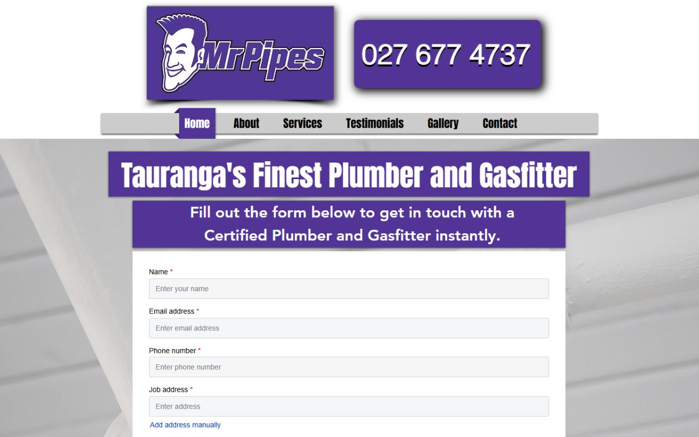
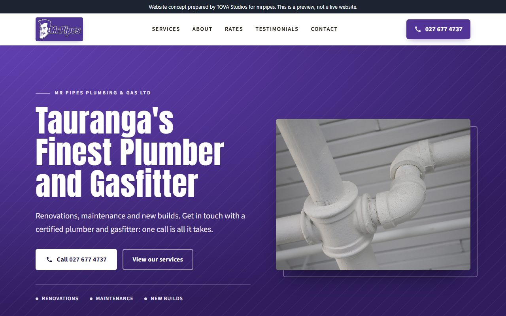
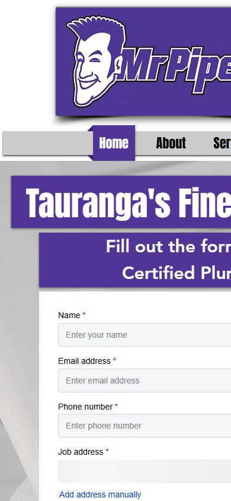
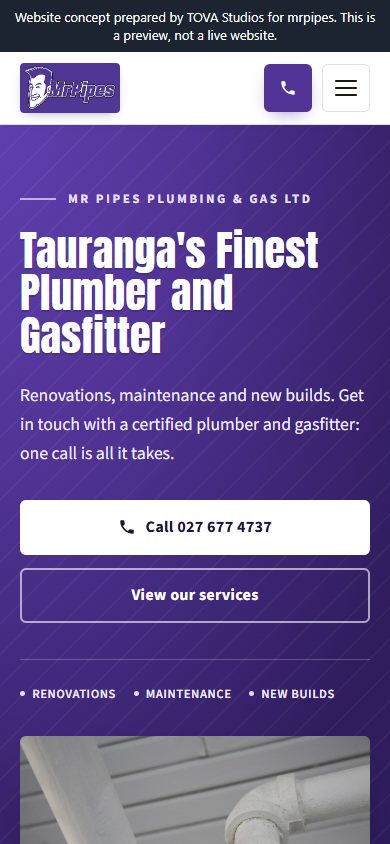
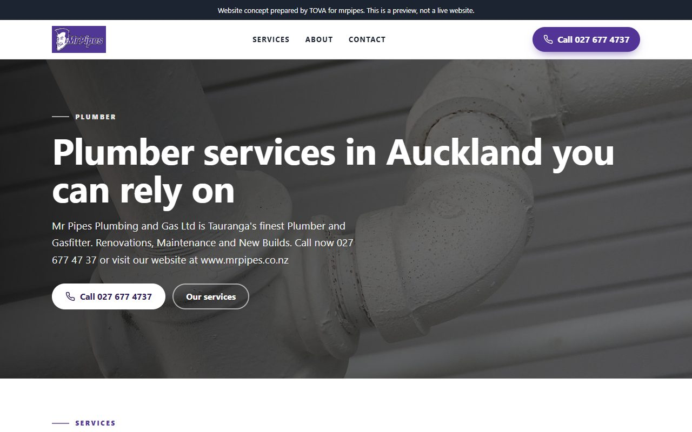

# Mr Pipes Plumbing and Gas Ltd: website concept

A free website concept prepared by **TOVA Studios** for Mr Pipes Plumbing and Gas Ltd.

### [View the concept website](https://tova-studio.github.io/mr-pipes-plumbing-and-gas/)

This is a **concept**, not your live website. Nothing has been changed on your current site.

## Before and after

| Your current website | The concept |
| --- | --- |
|  |  |
|  |  |

## Two versions

A simpler version and a fully designed version are both included. The simpler one is `basic.html`.

## What the concept improves

- Add a clear "Get a quote" button above the fold
- Set up Google Business Profile links and local SEO
- Monthly updates and performance reporting

## A simple monthly plan

**TOVA Essential**: from NZ$149/month + GST. The website build itself is included. See `proposal.pdf` (or `proposal.html`) for the full proposal.

## About the images and details

The logo, photos and contact details come from your own website and public listings so that the concept looks like you. If you would rather any of them were removed, tell us and we will remove them straight away.

## Get in touch

Reply to the email you received, or contact lily.barnett123@gmail.com.

If you would rather not hear from us, just say so and we will not contact you again.
